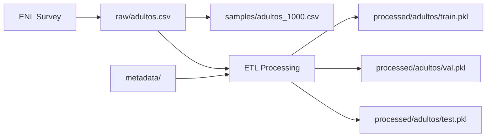

# 📊 Data - Gestión de Datos del Clasificador

Esta carpeta contiene toda la gestión de datos para el clasificador de hábitos de lectura.

## 📁 Estructura

```
data/
├─ raw/                    # Datos originales (INMUTABLES)
├─ processed/              # Datos preprocesados por grupo
├─ samples/                # Muestras de 1000 registros
├─ metadata/               # Diccionarios de mapeo
└─ scripts/                # Scripts de utilidad
```

---

## 📂 Carpetas

### `raw/` - Datos Originales

**Descripción:** Datos crudos de la Encuesta Nacional de Lectura (ENL-GdB-pe)

**Archivos esperados:**
```
raw/
├─ adultos.csv    # ~74,000 registros (18+ años)
├─ jovenes.csv    # ~XX,XXX registros (12-17 años)
└─ ninos.csv      # ~XX,XXX registros (0-11 años)
```

**⚠️ IMPORTANTE:**
- **NO modificar** estos archivos
- Son la fuente de verdad
- Mantener backup externo
- Agregar a `.gitignore` (datos sensibles)

---

### `processed/` - Datos Procesados

**Descripción:** Datos transformados y divididos en train/val/test

**Estructura por grupo:**
```
processed/
├─ adultos/
│  ├─ train.pkl              # 70% de datos procesados
│  ├─ val.pkl                # 15% de datos procesados
│  ├─ test.pkl               # 15% de datos procesados
│  ├─ feature_names.txt      # Nombres de features post-transformación
│  ├─ label_encoder.pkl      # Encoder de clases
│  ├─ column_transformer.pkl # Transformador de columnas
│  └─ data_stats.json        # Estadísticas del dataset
├─ jovenes/
│  └─ ... (misma estructura)
└─ ninos/
   └─ ... (misma estructura)
```

**Generación:**
```bash
# Se genera automáticamente durante entrenamiento
python experiments/01_train_baseline.py
```

---

### `samples/` - Muestras para Desarrollo

**Descripción:** Subconjuntos de 1000 registros para desarrollo rápido

**Archivos:**
```
samples/
├─ adultos_1000.csv
├─ jovenes_1000.csv
└─ ninos_1000.csv
```

**Uso:**
```bash
# Crear muestras
python data/scripts/create_samples.py --size 1000

# Entrenar con muestras (rápido, ~5-10 min)
python experiments/01_train_baseline.py \
  --config configs/experiments/sample_test.yaml
```

---

### `metadata/` - Diccionarios de Mapeo

**Descripción:** Mapeos de códigos a etiquetas legibles

**Archivos esperados:**
```
metadata/
├─ P505_mapping.xlsx   # Variable P505: Código → Etiqueta
├─ P506_mapping.xlsx
├─ P507_mapping.xlsx
└─ ... (otros mapeos)
```

**Formato de archivo Excel:**
```
| Código | Etiqueta                  |
|--------|---------------------------|
| 1      | Nunca                     |
| 2      | Rara vez                  |
| 3      | Ocasionalmente            |
| 4      | Frecuentemente            |
| 5      | Muy frecuentemente        |
```

**Copiar desde:**
```bash
# Copiar metadata desde proyecto antiguo
cp ../Old_Teoria/MLP_Adul_s/data/metadata/*.xlsx data/metadata/
```

---

### `scripts/` - Scripts de Utilidad

**Scripts disponibles:**

#### 1. `create_samples.py` - Crear muestras
```bash
python data/scripts/create_samples.py \
  --size 1000 \
  --random_state 42
```

#### 2. `validate_data.py` - Validar integridad
```bash
python data/scripts/validate_data.py \
  --data_dir data/raw/
```

#### 3. `data_statistics.py` - Estadísticas descriptivas
```bash
python data/scripts/data_statistics.py \
  --grupo adultos \
  --output data/processed/adultos/stats.html
```

---

## 🔄 Flujo de Datos



1. **Datos originales** → `raw/`
2. **Crear muestras** → `samples/` (opcional, para dev)
3. **Procesamiento ETL** → `processed/` (automático durante entrenamiento)
4. **Entrenamiento** usa `processed/`

---

## 📋 Variables del Dataset

### Variables Categóricas (Ejemplos)
- `P505` - `P509`: Preguntas demográficas
- `P201`, `P203`, `P206` - `P208`: Características socioculturales
- `P311`: Hábitos de lectura
- `P315_1` - `P315_6`: Tipos de lectura

### Variables Numéricas
- `FACTORFINAL_HOGAR`: Factor de expansión del hogar
- `P210_A`: Edad en años
- `P210_M`: Edad en meses
- `P310_N`, `P310_A`: Variables de frecuencia

### Variable Objetivo
- `habito_lectura_completo` o derivada de `P517`:
  - `no_lector` (0)
  - `lector_medio` (1)
  - `lector_frecuente` (2)

---

## ⚠️ Anti-Leakage

**Variables EXCLUIDAS del entrenamiento:**
- `P517`: Variable objetivo directa
- `P311`: Correlacionada con target
- `P409`: Fuga de información
- `P315_1` - `P315_6`: Usadas para construir target
- `lectura_score`: Variable derivada intermedia

Estas variables se excluyen automáticamente en el ETL.

---

## 🚀 Guía Rápida

### Setup Inicial (Primera vez)

```bash
# 1. Copiar datos originales
cp ../Old_Teoria/MLP_Adul_s/data/raw/adultos.csv data/raw/
cp ../Old_Teoria/MLP_Jov/data/raw/jovenes.csv data/raw/
cp ../Old_Teoria/MLP_Nino/data/raw/ninos.csv data/raw/

# 2. Copiar metadata
cp -r ../Old_Teoria/MLP_Adul_s/data/metadata/*.xlsx data/metadata/

# 3. Crear muestras para desarrollo
python data/scripts/create_samples.py --size 1000

# 4. Validar datos
python data/scripts/validate_data.py
```

### Durante Desarrollo

```bash
# Usar muestras de 1k para experimentos rápidos
python experiments/01_train_baseline.py \
  --config configs/experiments/sample_test.yaml \
  --epochs 5
```

### Para Producción Final

```bash
# Usar datos completos (~74k)
python experiments/01_train_baseline.py \
  --config configs/experiments/baseline_all.yaml
```

---

## 📊 Estadísticas de Datos (Ejemplo)

### Adultos (~74,000 registros)

| Grupo Etario | Registros | No Lector | Lector Medio | Lector Frecuente |
|--------------|-----------|-----------|--------------|------------------|
| Adultos      | ~74,000   | ~45%      | ~35%         | ~20%             |
| Jóvenes      | ~XX,XXX   | ~XX%      | ~XX%         | ~XX%             |
| Niños        | ~XX,XXX   | ~XX%      | ~XX%         | ~XX%             |

*(Actualizar con estadísticas reales)*

---

## 🔒 Seguridad y Privacidad

- ⚠️ **NO versionar** archivos `.csv` en Git (agregados a `.gitignore`)
- ⚠️ Los datos contienen información demográfica sensible
- ✅ Solo versionar scripts y configs
- ✅ Compartir solo datos agregados/anonimizados

---

**Última actualización:** Octubre 2025
