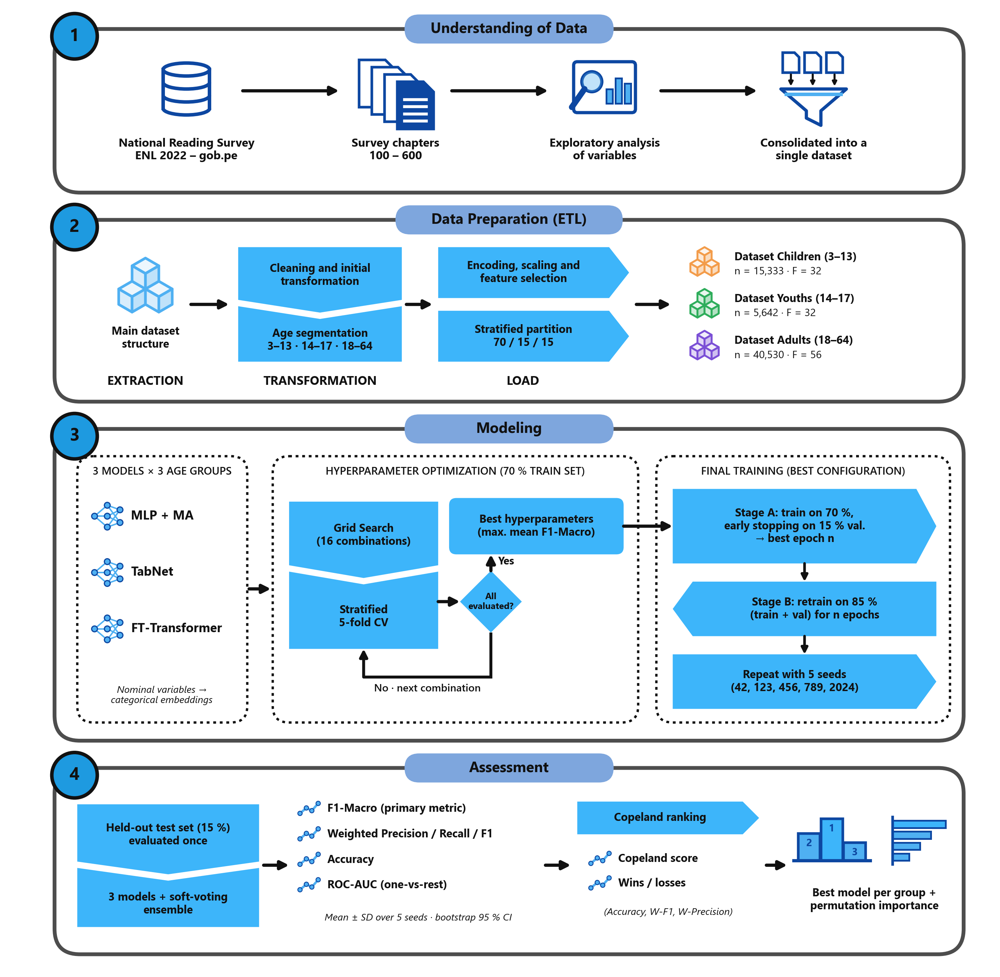

# Deep Neural Network Models to Classify the Reading Behavior of Peruvians

Code, data and results for the article

> **Deep neural network models to classify the reading behavior of Peruvians according to demographic and sociocultural characteristics**
> Submitted to the *International Journal of Information and Education Technology* (IJIET).

The study compares three deep learning architectures for tabular data (**MLP with multi-head attention**, **TabNet** and **FT-Transformer**) and their **soft-voting ensemble** for classifying people into three reading-behavior classes (*non-reader*, *average reader*, *frequent reader*). It uses the microdata of Peru's **2022 National Reading Survey (ENL 2022)** and trains a separate model for each of three age groups: children (3–13 years), youths (14–17) and adults (18–64).

Everything needed to check the article is in this repository: the input data, the full pipeline, the configuration, the trained models of the reported run, every test prediction and the scripts that rebuild each table and figure.



---

## Contents

1. [Repository map](#1-repository-map)
2. [Data](#2-data)
3. [Method](#3-method)
4. [Results of the reported run](#4-results-of-the-reported-run)
5. [Where each table and figure comes from](#5-where-each-table-and-figure-comes-from)
6. [Reproducing the study](#6-reproducing-the-study)
7. [Computing environment](#7-computing-environment)
8. [Glossary of Spanish names](#8-glossary-of-spanish-names)
9. [Citation and license](#9-citation-and-license)

---

## 1. Repository map

```
.
├── README.md                     This document
├── LICENSE                       MIT license
├── requirements.txt              Python dependencies (install PyTorch first, see section 6)
├── run_pipeline.py               Single command-line entry point (check, etl, smoke, train, report)
│
├── configs/
│   └── pipeline.yaml             Single source of truth: age groups, target, splits, preprocessing,
│                                 hyperparameter grid, training settings, seeds and paths
│
├── src/aligned/                  Pipeline package ("aligned" = implementation aligned with the manuscript)
│   ├── config.py                 Loads pipeline.yaml and rejects values that contradict the article
│   ├── variables.py              ENL variable registry: predictors, nominal columns, leakage guard
│   ├── target.py                 Construction of the three reading-behavior classes
│   ├── features.py               Derived indicators, household context, feature selection
│   ├── etl.py                    End-to-end ETL with hard consistency checks
│   ├── balancing.py              Class weights (SMOTE optional), applied only inside each fit
│   ├── models.py                 MLP+MA, TabNet and FT-Transformer, with categorical embeddings
│   ├── trainer.py                AdamW training loop, early stopping, learning curves
│   ├── gridsearch.py             Grid Search with stratified 5-fold cross-validation
│   ├── pipeline.py               CV → stage A → stage B → test → five seeds → interpretability
│   ├── evaluate.py               Metrics, macro one-vs-rest AUC, Copeland ranking
│   ├── report.py                 Tables and figures, built only from saved results
│   └── benchmark.py              Training-time estimation for a given GPU
│
├── tests/
│   └── test_aligned.py           Unit and integration tests (pytest)
│
├── data/                         See data/README.md
│   ├── raw/                      ENL 2022 extracts: ninos.csv, jovenes.csv, adultos.csv
│   ├── dictionaries/             Official ENL data dictionaries (Spanish)
│   └── processed/                ETL output per age group: train/val/test .parquet + config.json
│
├── results/                      See results/README.md
│   └── final/                    Run reported in the article: one folder per group × model with
│                                 metrics, predictions, learning curves, Grid Search and weights
│
├── reports/
│   └── final/                    Tables (CSV/LaTeX) and figures generated from results/final
│
├── paper/
│   ├── make_article_figures.py   Rebuilds Figs. 7–12 and Table 4 of the article from results/final
│   ├── figures/                  Output: the article's result figures (English)
│   └── tables/                   Output: Table 4 (AUC per class)
│
└── docs/
    ├── PIPELINE_DESIGN.md        Design decisions, target definition, leakage controls, data corrections
    ├── TRAINING_GUIDE.md         Step-by-step guide to retrain on a GPU workstation
    └── pipeline_overview.png     Fig. 1 of the article
```

**Folders that are not versioned.** New runs write to `results/latest/` and `reports/latest/`, and the smoke test to `results/_smoke/` and `reports/_smoke/`. Only the reported run (`final`) is kept in the repository.

---

## 2. Data

**Source.** *Encuesta Nacional de Lectura 2022* (ENL 2022), carried out by Peru's National Institute of Statistics and Informatics (INEI) with the Ministry of Culture and published on the Peruvian National Open Data Platform (<https://www.datosabiertos.gob.pe>). The microdata are public and anonymized.

`data/raw/` contains the person-level extracts used in the study, with the survey chapters merged for each person: household members (chapter 200), sociocultural characteristics and reading practices of people aged 18–64 (chapters 300–400), reading practices of people aged 0–17 (chapter 500), and the household and sample-design identifiers. The files came split into age bands (0–15, 16–27 and 28–99). The ETL joins them and segments them again by exact age, as described in the article. `data/README.md` describes every file.

**Age groups and classes.** The class measures **book reading** in every group:

| Group | Ages | Source question | Frequent reader | Average reader | Non-reader |
|---|---|---|---|---|---|
| Children | 3–13 | P506: how often the person reads books | daily or several times a week | from once a week to once a month | every three months or less, or never |
| Youths | 14–17 | P506 (same rule) | | | |
| Adults | 18–64 | P408 (read books in the last 12 months) + P409 (frequency) | daily or several times a week | from once a week to once a month | every three months or less, or did not read books (P408 = no) |

Adults are limited to 18–64 years because the ENL applies chapters 300–400 only in that range. "Don't know / no answer" answers are discarded.

**Final datasets** (`data/processed/<group>/config.json` records every step):

| Group | Records | Non-reader | Average reader | Frequent reader | Features (F) | Train / Val / Test |
|---|---|---|---|---|---|---|
| Children (3–13) | 15,333 | 2,632 (17.2%) | 4,095 (26.7%) | 8,606 (56.1%) | 32 | 10,733 / 2,300 / 2,300 |
| Youths (14–17) | 5,642 | 751 (13.3%) | 1,556 (27.6%) | 3,335 (59.1%) | 32 | 3,949 / 846 / 847 |
| Adults (18–64) | 40,530 | 23,216 (57.3%) | 6,539 (16.1%) | 10,775 (26.6%) | 56 | 28,371 / 6,079 / 6,080 |

Children and youths have fewer features because the ENL asks the socioeconomic chapter (education, occupation, income, mother tongue, ethnicity) only to adults. To give minors sociocultural information, the ETL adds **household-context indicators** (`hh_*`) computed from the adults of their household.

---

## 3. Method

### 3.1 Data preparation (`src/aligned/etl.py`)

1. Harmonize the three extracts (`jovenes.csv` codes "not applicable" as blank and the others as 0) and join them.
2. Segment by exact age (3–13, 14–17, 18–64) and build the target (section 2).
3. Remove records with more than 20% missing values.
4. Build derived indicators: Digital Access Index (approximated from socioeconomic stratum, size of populated center and school attendance, because the survey's household-equipment chapter is not in the extracts), educational level, household context (education, literacy, mother tongue, Indigenous membership, employment rate, income, household composition) and linguistic environment.
5. Remove every variable about reading behavior. `variables.is_leaky()` blocks them by pattern, and `assert_no_leakage()` checks the matrix again after preprocessing, when loading the data and in the tests.
6. Stratified split: 70% train, 15% validation, 15% test (seed 42).
7. Fitted **on the training split only**: imputation (median for numeric variables, an explicit "no data" category for categorical ones), Label Encoding, `log(1 + x)` for income, Min–Max scaling, variance threshold (0.005) and correlation filter (|r| > 0.95).
8. Hard checks: no leakage, and the same columns in the three splits.

### 3.2 Models (`src/aligned/models.py`)

| Model | Architecture (fixed by the article) |
|---|---|
| **MLP+MA** | Each feature becomes a token; multi-head self-attention (4 heads, dimension 64) weights the features before a 256 → 128 → 64 → 32 MLP with ReLU and dropout |
| **TabNet** | 3 decision steps with sparsemax masks (n_d = n_a = 32, γ = 1.3) |
| **FT-Transformer** | Feature tokenizer with 64-dimensional embeddings, `[CLS]` token, 4 Transformer encoder layers (8 heads, feed-forward 256) |
| **Ensemble** | Soft voting: average of the three models' class probabilities, computed seed by seed |

**Nominal variables** (department, geographic domain, socioeconomic stratum, mother tongue, ethnicity, marital status, occupation, type of school, among others) enter the three models as **learned embeddings**, not as numbers: the feature tokenizer in FT-Transformer, the variable's attention token in MLP+MA, and TabNet's native categorical embeddings (dimension min(4, k − 1)). Ordinal and binary variables enter as scalars.

### 3.3 Training and evaluation protocol (`src/aligned/pipeline.py`)

For each of the 9 group × architecture combinations:

1. **Hyperparameter search** (`gridsearch.py`): Grid Search with **stratified 5-fold cross-validation on the 70% training split**, selecting by mean F1-Macro. Grid (`standard` preset): learning rate {10⁻³, 10⁻⁴}, batch size {64, 128}, dropout {0.2, 0.3} and weight decay {10⁻⁵, 10⁻⁴}, i.e. 16 configurations for MLP+MA and FT-Transformer. TabNet uses the learning rates recommended by its authors {0.02, 0.005} and has no dropout, so it gets 8 configurations. CV uses at most 60 epochs (patience 12) to keep the cost manageable.
2. **Stage A:** train on the 70% split and validate on the 15% validation split, up to 200 epochs with early stopping (patience 20) on the weighted validation loss. This gives the learning curves (Fig. 11) and the best epoch *n*.
3. **Stage B:** retrain on 85% of the data (train + validation) for exactly *n* epochs.
4. **Test:** evaluate **once** on the 15% test split, which is never used for any decision.
5. **Stability:** repeat stage B and the test with five seeds (42, 123, 456, 789, 2024). Tables report mean ± standard deviation. The seed-42 model is the saved one.

Common settings: AdamW, cross-entropy weighted by inverse class frequency (no synthetic oversampling), gradient clipping at 1.0, ReduceLROnPlateau (patience 10, factor 0.5) and mixed precision on GPU.

**Metrics** (`evaluate.py`): Accuracy, weighted Precision/Recall/F1, **F1-Macro (main metric)** and macro one-vs-rest AUC.

**Copeland ranking:** within each group, every pair of classifiers is compared on Accuracy, F1-Weighted and Precision-Weighted (means over seeds). A classifier wins the pair if it is better on at least two of the three metrics. Its score is wins minus losses (−3 to +3 per group) and the global score is the sum over the three groups (−9 to +9).

**Interpretability:** permutation importance, measured as the drop in test F1-Macro when one feature is permuted (2,048 test rows, the same measure for the three architectures). The report also includes the attention weights (MLP+MA, FT-Transformer) and the masks (TabNet).

---

## 4. Results of the reported run

Test set, mean ± standard deviation over five seeds (`reports/final/tabla3_media_std.csv`):

| Group | Model | Accuracy | F1-Weighted | **F1-Macro** | Macro AUC |
|---|---|---|---|---|---|
| Children | MLP+MA | 0.534 ± 0.021 | 0.525 ± 0.008 | 0.465 ± 0.007 | 0.661 ± 0.008 |
| | TabNet | 0.513 ± 0.016 | 0.505 ± 0.007 | 0.442 ± 0.006 | 0.637 ± 0.011 |
| | FT-Transformer | 0.559 ± 0.019 | 0.544 ± 0.010 | 0.479 ± 0.005 | 0.664 ± 0.003 |
| | **Ensemble** | 0.555 ± 0.009 | 0.544 ± 0.005 | **0.482 ± 0.008** | **0.667 ± 0.005** |
| Youths | MLP+MA | 0.481 ± 0.032 | 0.489 ± 0.022 | 0.415 ± 0.013 | 0.616 ± 0.006 |
| | TabNet | 0.448 ± 0.115 | 0.422 ± 0.135 | 0.356 ± 0.077 | 0.593 ± 0.029 |
| | FT-Transformer | 0.486 ± 0.034 | 0.501 ± 0.028 | 0.435 ± 0.015 | **0.650 ± 0.004** |
| | **Ensemble** | 0.517 ± 0.014 | 0.525 ± 0.010 | **0.447 ± 0.008** | 0.640 ± 0.008 |
| Adults | MLP+MA | 0.571 ± 0.007 | 0.584 ± 0.004 | 0.494 ± 0.004 | 0.720 ± 0.002 |
| | TabNet | 0.537 ± 0.014 | 0.563 ± 0.012 | 0.480 ± 0.008 | 0.708 ± 0.007 |
| | FT-Transformer | 0.584 ± 0.013 | 0.589 ± 0.006 | 0.490 ± 0.005 | 0.721 ± 0.003 |
| | **Ensemble** | 0.580 ± 0.006 | 0.593 ± 0.003 | **0.500 ± 0.003** | **0.727 ± 0.001** |

Reference values for F1-Macro: 0.33 for a stratified random classifier and about 0.24 for always predicting the majority class.

* **Copeland (global):** Ensemble +9, FT-Transformer +3, MLP+MA −3, TabNet −9.
* **Most influential features (permutation importance):** department of residence for children and youths, and educational level for adults.
* **Stage-A best epochs** (length of the final retraining): between 11 and 45 depending on the combination (`reports/final/tabla2_hiperparametros.csv`).

---

## 5. Where each table and figure comes from

| In the article | File | Built by |
|---|---|---|
| Data description (records, classes, features) | `reports/final/tabla_resumen_datos.csv` | `run_pipeline.py report` |
| Table 2 · selected hyperparameters | `reports/final/tabla2_hiperparametros.csv` (+ `results/final/*/gridsearch_results.csv` for every configuration) | `run_pipeline.py report` |
| Table 3 · metrics, mean ± SD of five seeds | `reports/final/tabla3_media_std.csv` / `.tex` | `run_pipeline.py report` |
| Table 4 · AUC per class, mean of five seeds | `paper/tables/table4_auc_per_class.csv` | `paper/make_article_figures.py` |
| Ensemble analysis in the text | `reports/final/tabla_ensemble.csv` | `run_pipeline.py report` |
| Fig. 1 · pipeline overview | `docs/pipeline_overview.png` | diagram |
| Figs. 2–6 · architectures and training flow | in the manuscript | diagrams |
| Fig. 7 · performance comparison | `paper/figures/fig07_comparison.png` | `paper/make_article_figures.py` |
| Fig. 8 · confusion matrices (mean of seeds) | `paper/figures/fig08_confusion.png` | `paper/make_article_figures.py` |
| Fig. 9 · macro ROC curves (mean of classes and seeds) | `paper/figures/fig09_roc.png` | `paper/make_article_figures.py` |
| Fig. 10 · Copeland ranking | `paper/figures/fig10_copeland.png` (scores: `reports/final/copeland_*.csv`) | `paper/make_article_figures.py` |
| Fig. 11 · learning curves (stage A) | `paper/figures/fig11_learning_curves.png` | `paper/make_article_figures.py` |
| Fig. 12 · permutation importance | `paper/figures/fig12_importance.png` | `paper/make_article_figures.py` |

`reports/final/` also contains the figures that the pipeline draws by itself (`fig_*.png`, Spanish labels). They show the same results, but Figs. 8 and 9 there use only the seed-42 model, while the article averages the five seeds. Each `reports/final` file is described in `reports/final/INDICE_FIGURAS.md`.

---

## 6. Reproducing the study

### 6.1 Installation

Python 3.12 is recommended. Install **PyTorch first**, from the index that matches your CUDA version, and then the rest. If the order is reversed, pip installs the CPU build without warning.

```bash
git clone https://github.com/AaronAP1/MLP_Classificador.git
cd MLP_Classificador
python -m venv .venv
source .venv/bin/activate              # Windows: .venv\Scripts\activate
pip install torch --index-url https://download.pytorch.org/whl/cu126
pip install -r requirements.txt
```

### 6.2 Check the installation

```bash
python run_pipeline.py check           # dependencies, GPU, data and configuration
python -m pytest tests/ -q             # all tests must pass
```

### 6.3 Rebuild the article's tables and figures from the saved run (minutes, no GPU)

```bash
python run_pipeline.py report --tag final    # reports/final: tables 2-3, ensemble, Copeland
python paper/make_article_figures.py         # paper/figures and paper/tables: Figs. 7-12, Table 4
```

`report --tag final` reads `results/final/` and rewrites `reports/final/`. Its tables come out byte-identical to the versioned ones.

### 6.4 Retrain from scratch (GPU, about 15 hours on an RTX 4060)

```bash
python run_pipeline.py etl             # data/raw → data/processed (~10 s)
python run_pipeline.py smoke           # whole pipeline with little data (~5 min); checks the code, gives no results
python run_pipeline.py train           # Grid Search + CV + stages A/B + test + five seeds → results/latest
python run_pipeline.py report          # tables and figures → reports/latest
```

Useful options: `--groups ninos jovenes adultos`, `--models mlp_ma tabnet ft_transformer`, `--preset fast|standard|paper` (size of the grid), `--tag <name>` (writes to `results/<name>` and `reports/<name>`). Training can be resumed: every combination saves its `results.json` as soon as it ends. `docs/TRAINING_GUIDE.md` covers the full procedure, the expected messages and troubleshooting.

**Reproducibility.** Seed 42 is propagated to NumPy, PyTorch, the splits, the folds and the balancing. Each `results.json` stores the complete configuration, the hyperparameters, the hardware and the training time that produced it. GPU kernels are not fully deterministic, so a new run can differ from the reported one in the third decimal place.

---

## 7. Computing environment

The reported run (`results/final/run_summary.json`):

| | |
|---|---|
| GPU | NVIDIA GeForce RTX 4060, 8 GB, CUDA 12.6 |
| Software | Python 3.12.4, PyTorch 2.14.1+cu126, pytorch-tabnet, scikit-learn |
| Operating system | Windows 11 |
| Total training time | 15.0 h for the 9 combinations (Grid Search, stages A/B and five seeds) |

---

## 8. Glossary of Spanish names

The code, the configuration comments and the pipeline's own output files use Spanish names, the language in which the study was developed.

| Spanish | English |
|---|---|
| `ninos`, `jovenes`, `adultos` | children (3–13), youths (14–17), adults (18–64) |
| No Lector, Lector Medio, Lector Frecuente (class indices 0, 1, 2) | non-reader, average reader, frequent reader |
| `tabla`, `figura`, `fig_` | table, figure |
| `media`, `desv.`, `semilla` | mean, standard deviation, seed |
| `curvas de aprendizaje`, `matrices de confusión` | learning curves, confusion matrices |
| `importancia (por permutación)`, `interpretabilidad` | (permutation) importance, interpretability |
| `etapa A / etapa B`, `mejor época` | stage A / stage B, best epoch |
| `hiperparámetros finales`, `protocolo`, `diagnóstico` | final hyperparameters, protocol, diagnostics |
| `hh_*` (*hogar*) | household-context indicator |
| `idx_*` (*índice*) | derived index |

---

## 9. Citation and license

If you use this code or these results, please cite the article (citation details will be added after publication):

> S. E. Vega-Sanchez, A. A. Aquino-Poma, L. A. Matos-Urdanivia and N. Saboya, "Deep neural network models to classify the reading behavior of Peruvians according to demographic and sociocultural characteristics," *International Journal of Information and Education Technology* (under review).

The code is distributed under the MIT license ([LICENSE](LICENSE)). The ENL 2022 microdata belong to INEI and the Ministry of Culture of Peru and are redistributed here, as open data, only to make the study reproducible.

Contact: Universidad Peruana Unión, Lima, Peru · repository maintained by [AaronAP1](https://github.com/AaronAP1).
