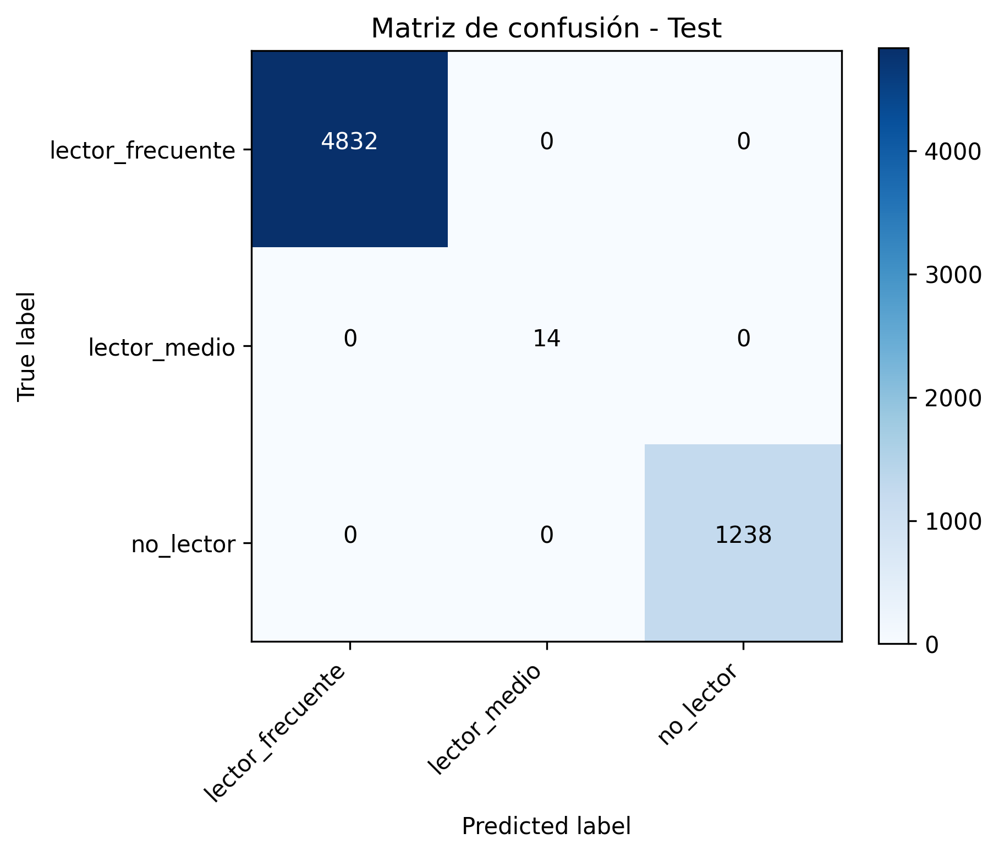
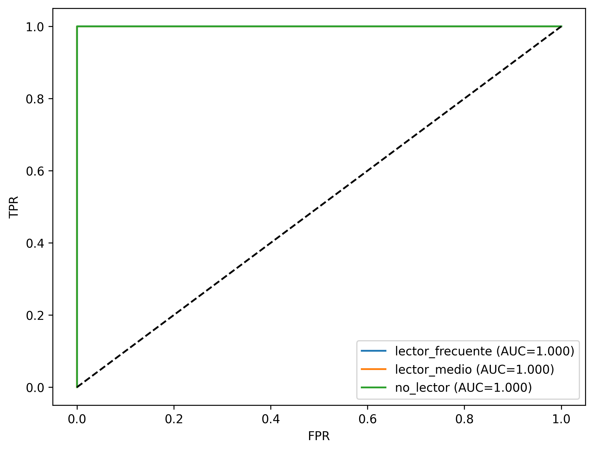
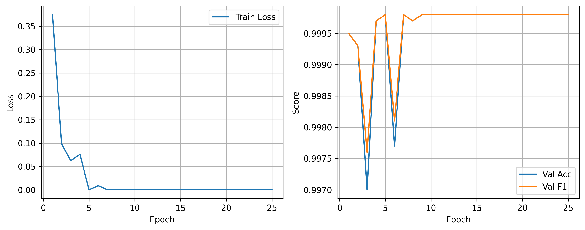
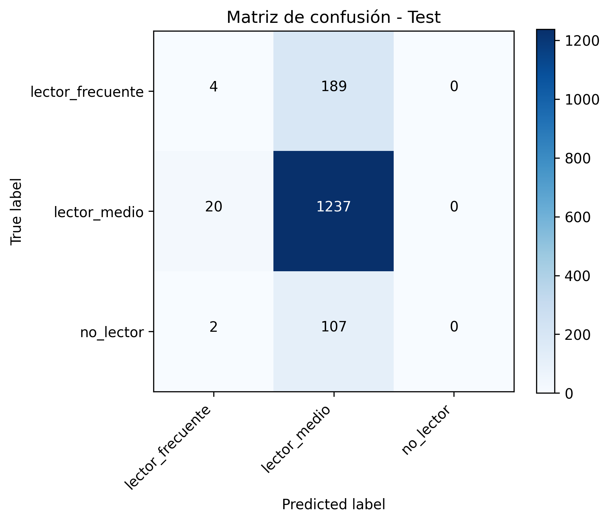
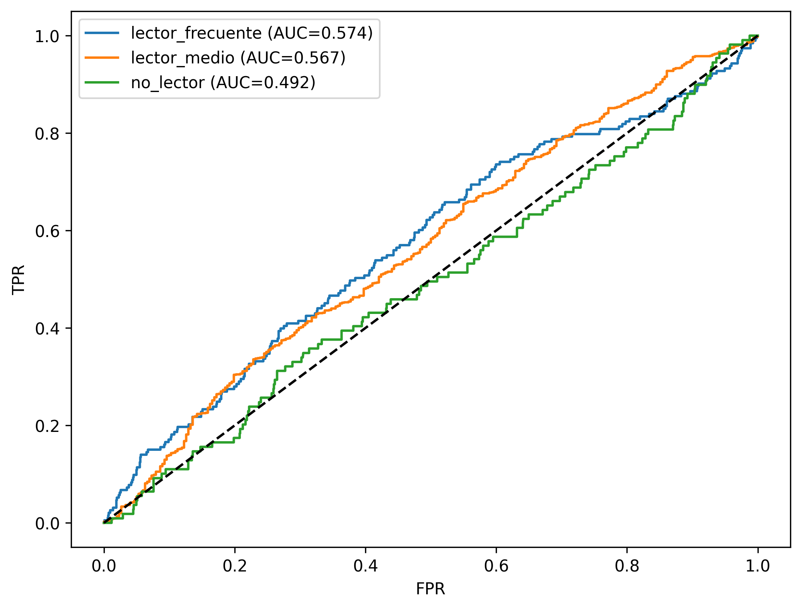
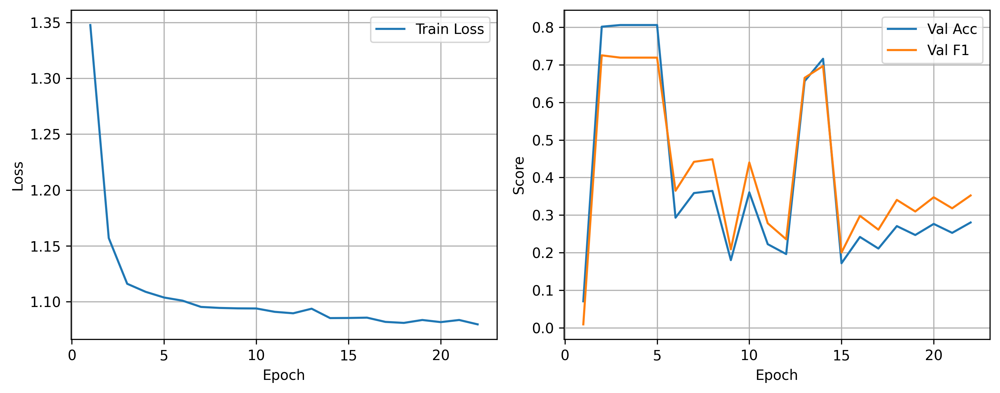

# Clasificación de hábitos de lectura (3 pipelines)

Este repositorio contiene tres pipelines equivalentes para clasificar el hábito lector en tres clases (no_lector, lector_medio, lector_frecuente):
- MLP_MA: MLP con mecanismo de atención a nivel de entrada.
- FT-Transformer: Transformer para datos tabulares con tokenización de features.
- TabNet: Modelo TabNet (pytorch-tabnet) para interpretación y rendimiento en tabulares.

Cada pipeline incluye: ETL con guardrails anti-fuga, splits 70/15/15 estratificados, entrenamiento con early stopping y ReduceLROnPlateau, métricas macro/weighted y visualizaciones.

## Datos y estructura
- Datos crudos por grupo etario (adultos, jóvenes, niños):
  - MLP_Adul_s/data/raw/adultos.csv
  - MLP_Jov/data/raw/jovenes.csv
  - MLP_Nino/data/raw/ninos.csv
- Salidas por corrida: `outputs/models/<run_id>/` y `outputs/plots/<run_id>/` dentro de cada carpeta de modelo.
- Configs por grupo: `configs/config_*.json` y `configs/paths_*.json` por pipeline.

## Requisitos
- Python 3.12
- GPU opcional; AMP se desactiva automáticamente si no hay CUDA.
- Instalar dependencias por pipeline:
  - MLP_MA: `pip install -r MLP_MA/requirements.txt`
  - FT-Transformer: `pip install -r FT-Transformer/requirements.txt`
  - TabNet: `pip install -r TabNet/requirements.txt`

## Cómo ejecutar (corridas rápidas de ejemplo, 5 épocas)
- MLP_MA (Niños):
  ```powershell
  C:/Users/xdxdxdxd/AppData/Local/Programs/Python/Python312/python.exe "c:\Users\xdxdxdxd\Desktop\MLP_Py_In01\MLP_MA\main.py" --config "c:\Users\xdxdxdxd\Desktop\MLP_Py_In01\MLP_MA\configs\config_ninos.json" --paths "c:\Users\xdxdxdxd\Desktop\MLP_Py_In01\MLP_MA\configs\paths_ninos.json" --max_epochs 5
  ```
- FT-Transformer (Niños):
  ```powershell
  C:/Users/xdxdxdxd/AppData/Local/Programs/Python/Python312/python.exe "c:\Users\xdxdxdxd\Desktop\MLP_Py_In01\FT-Transformer\main.py" --config "c:\Users\xdxdxdxd\Desktop\MLP_Py_In01\FT-Transformer\configs\config_ninos.json" --paths "c:\Users\xdxdxdxd\Desktop\MLP_Py_In01\FT-Transformer\configs\paths_ninos.json" --max_epochs 5
  ```
- TabNet (Niños):
  ```powershell
  C:/Users/xdxdxdxd/AppData/Local/Programs/Python/Python312/python.exe "c:\Users\xdxdxdxd\Desktop\MLP_Py_In01\TabNet\main.py" --config "c:\Users\xdxdxdxd\Desktop\MLP_Py_In01\TabNet\configs\config_ninos.json" --paths "c:\Users\xdxdxdxd\Desktop\MLP_Py_In01\TabNet\configs\paths_ninos.json" --max_epochs 5
  ```

Cambia `config_*` y `paths_*` por `adultos` o `jovenes` para otras corridas.

## ETL y anti-fuga
- Construcción de target automática:
  - Si `habito_3clases` o `habito_lectura_completo` no existen, se construyen a partir de P517 y/o un `lectura_score` agregado.
- Variables excluidas para evitar fuga (según disponibilidad): `P517`, `P311`, `P409`, `lectura_score`, `P315_1..P315_6`.
- FT-Transformer mapea categóricas a índices por columna con índice OOV; MLP_MA usa ColumnTransformer (OHE + StandardScaler); TabNet prepara arrays con cat_idxs/cat_dims.

## Entrenamiento y métrica
- Optimizador AdamW (MLP_MA/FT), ReduceLROnPlateau en F1 macro, early stopping, class weights, grad clipping; AMP solo con CUDA.
- Métricas: accuracy, precision/recall/F1 weighted y macro, métricas por clase, ROC/PR AUC OVR; matrices de confusión y curvas de entrenamiento en `outputs/plots/<run_id>/`.

## Interpretabilidad
- MLP_MA: pesos de atención de entrada (script `analyze_attention.py`).
- FT-Transformer: embedding CLS y atención por capa (script `analyze_attention.py`).
- TabNet: máscaras de atención por paso de decisión (método `explain`).

## Azure ML (opcional, MLP_MA)
- Plantillas en `MLP_MA/azure/` (environment.yml, job.yml, README_AZURE.md) para lanzar jobs en Azure ML.

## Solución de problemas
- Métricas 100% o ROC AUC NaN en test (monoclasal): el split puede quedar con una sola clase. Ajusta `random_state`, tamaños de split, o fija un split estratificado que garantice todas las clases en cada partición.
- CUDA no disponible: AMP se desactiva automáticamente; los warnings son informativos.
- TabNet no importado: asegura `pip install -r TabNet/requirements.txt`.

## Dónde ver resultados
- Métricas finales: `outputs/models/<run_id>/final_test_metrics.txt`.
- Curvas de entrenamiento: `outputs/models/<run_id>/metrics_by_epoch.csv` y gráficos en `outputs/plots/<run_id>/`.

## Gráficos de rendimiento (mejor época actual, ejemplos)
- MLP_MA Niños (run 20250811_124724):
  - Matriz de confusión:
    
  - Curva ROC:
    
  - Curvas de entrenamiento:
    

- MLP_MA Jóvenes (run 20250811_131019):
  - Matriz de confusión:
    
  - Curva ROC:
    
  - Curvas de entrenamiento:
    

Nota: si alguna corrida dejó el test con una sola clase, las curvas ROC/PR pueden ser NaN o no informativas; vuelve a ejecutar con otro random_state.

## Últimas corridas por modelo (auto)
<!-- AUTO-PLOTS-START -->
### MLP_MA (run 20250811_124519)


### FT-Transformer (run 20250811_180018)


### TabNet (run 20250811_180018)


<!-- AUTO-PLOTS-END -->
